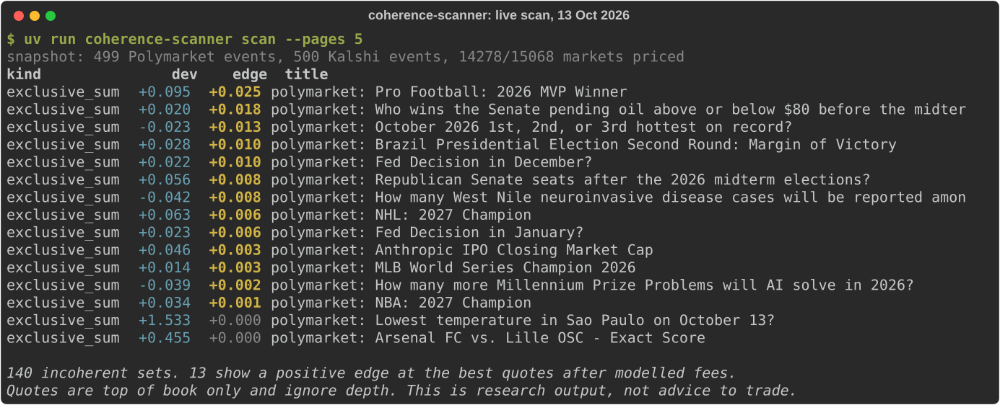
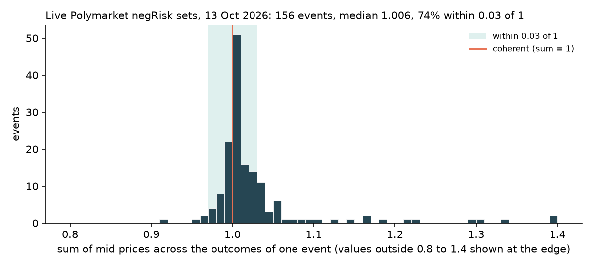

# coherence-scanner

Find where linked prediction markets contradict each other.

[](https://github.com/Guinerve/coherence-scanner/actions/workflows/ci.yml)
[](LICENSE)



Prices for related outcomes must obey the rules of probability. If an election has five candidates and exactly one will win, their prices should add up to about 1. If outcome A can only happen when B happens, A cannot cost more than B. The same event on two venues should have the same price.

coherence-scanner reads public prices from Polymarket and Kalshi and reports where these rules break. I built it to learn how often real markets are incoherent, and how much of that survives fees and the spread. Most of it does not.

The tool reads public data only. It needs no account or API key, and it has no code that places orders. I live in Australia, where ACMA blocks Polymarket, so this is a research project. A reported gap is a reason to read the market rules, not a signal to trade.

## Quick start

You need [uv](https://docs.astral.sh/uv/) and Python 3.11 or later.

```bash
git clone https://github.com/Guinerve/coherence-scanner.git
cd coherence-scanner
uv sync
uv run coherence-scanner scan
```

`scan` reads 3 pages of 100 events from each venue and prints the 15 largest problems. Useful options:

- `--pages 5` reads more events.
- `--top 30` shows more rows.
- `--json out.json` writes every violation, with the legs behind each edge figure.

To compare markets across the two venues, first collect candidate pairs:

```bash
uv run coherence-scanner propose
```

This adds pairs to `data/relations.yaml` with `status: proposed`. It prints the resolution rules from both venues next to each other. Read them, then change `status` to `approved` for each pair you trust. The next `scan` checks the approved pairs. Use `type: implies` when market `a` resolving Yes means market `b` must resolve Yes.

## How it works

1. **Snapshot.** The tool reads open events from Polymarket's Gamma API and Kalshi's public trade API. For each market it keeps the best bid, the best ask and the resolution rules.
2. **Price.** The mid price is the average of the bid and the ask. If only one side has quotes, the tool uses the last trade or the venue's displayed price. A book with no bids and no offers has no price.
3. **Check.** Three rules give three kinds of violation:
   - `exclusive_sum`: outcomes where only one can resolve Yes. If the venue says one must resolve Yes, the sum must be 1. Otherwise it must be 1 or less.
   - `nesting`: an approved `implies` pair, where P(A) must be at most P(B).
   - `cross_venue`: an approved `equivalent` pair, where both prices must be equal.
4. **Measure.** Each violation gets two numbers:
   - **deviation**: how far the mid prices are from the rule.
   - **edge**: the result of a full round trip at the best quotes after modelled fees, per $1 of payout.

   A deviation with no edge is almost always just the spread. Sets within 0.01 of coherent, and with no edge, are not reported.
5. **Approve.** A relation counts only after a person sets it to `approved`. The relations file has a version number, and the tool reports approved pairs it cannot find or price.

The repo also has a fair value function in `project.py`. It moves a set of prices to the nearest coherent set, measured by KL divergence, under the same constraints. It is tested but the `scan` report does not use it yet.

## Results

These numbers come from live runs on 13 October 2026.

**Live scan.** `scan --pages 5` read 499 Polymarket events and 500 Kalshi events. It priced 14,278 of 15,068 markets. It found 140 incoherent sets, and 13 of them showed a positive edge at the best quotes after modelled fees. The largest edge was 0.025 per $1, on the "Pro Football: 2026 MVP Winner" set. I have not checked these 13 by hand. The tool ignores order book depth, so each one is only a prompt to read that market closely.

**Do linked Polymarket sets add up to 1?** Polymarket groups some outcomes as negRisk events, where exactly one outcome resolves Yes. In 156 such events with 3 or more priced outcomes, the median sum of mid prices was 1.006. The 5th percentile was 0.981 and the 95th was 1.170. 74 % were within 0.03 of 1.



The long tail above 1 is mostly thin books. The scan above shows an example: a São Paulo temperature market on the day it resolves. Four outcomes had a bid of 0.02 and an ask of 0.99 or 1.00, so each mid was about 0.5. The set summed to 2.53, but the edge was zero. Make the chart again with `uv run --with matplotlib python scripts/negrisk_sums.py --out docs/negrisk-sums.png`.

**Bugs that live data found.** Unit tests with books I made by hand did not catch these three. A regression test now covers each one.

- Some negRisk events are "augmented". They hold inactive placeholder outcomes that can be named later. The 2028 Republican nominee event had 128 markets, 43 of them active, and the listed prices summed to 0.83. The scanner first reported this as an edge of 0.147. These events now count as exclusive, but they need not add up to 1.
- A market with no orders at all showed a price of 0.5 on both venues. Kalshi reports a bid of 0.00 and an ask of 1.00, and Polymarket shows 0.5 as its display price. This added about 0.5 to a set sum for each empty book. Empty books are now unpriced.
- Polymarket pages are sorted by live 24 hour volume, so an event can move to the next page between requests. In one run, 15 of 485 events came back twice and were counted twice. The scanner now keeps each event once.

**Synthetic test.** I made 50 random coherent books with 5 outcomes each and added 15 % noise to each price. The projection always gave prices that sum to 1. On average, the projected prices were closer to the true values than the noisy prices.

## Limits

- Fees are modelled. The model uses Kalshi's published taker fee, `ceil(0.07 × C × P × (1 - P))` rounded up to the cent. Polymarket has no fee in the model. Either schedule can change.
- Prices are the best bid and ask at one moment. Thin or stale books give large deviations that mean little, so read the edge column first.
- The edge assumes you can trade at the best quotes on every leg at once. It ignores depth, and it ignores what a sale needs in practice, such as holding the shares first.
- Some violations come from different resolution rules on each leg, while both prices are fair. Always read the rules of every leg.
- `propose` matches titles with rapidfuzz, not with a model. It is weak. In one run it paired a cricket match with a FIFA World Cup qualifier, and a 2026 rate question with a 2036 one. That is why every pair needs a person to approve it.
- I have no results across the two venues yet, because I have not approved any pairs.

## Roadmap

- Read order book depth from Polymarket's CLOB and Kalshi, and compute the edge at a realistic size.
- Better match proposals, measured against a set of pairs I label by hand.
- Show the fair value projection in the `scan` report.

## Development

```bash
uv sync
uv run pytest -q        # 30 tests, no network needed
uv run ruff check .
```

The tests use two recorded API responses in `tests/fixtures/` and books made by hand. CI runs ruff and pytest on every push.

## Licence

MIT. See [LICENSE](LICENSE).
